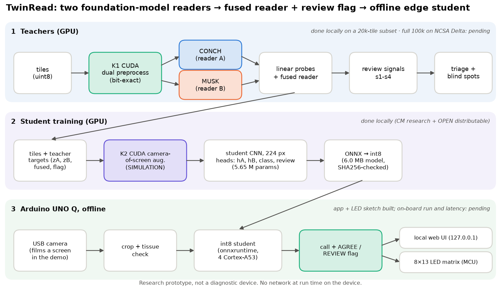
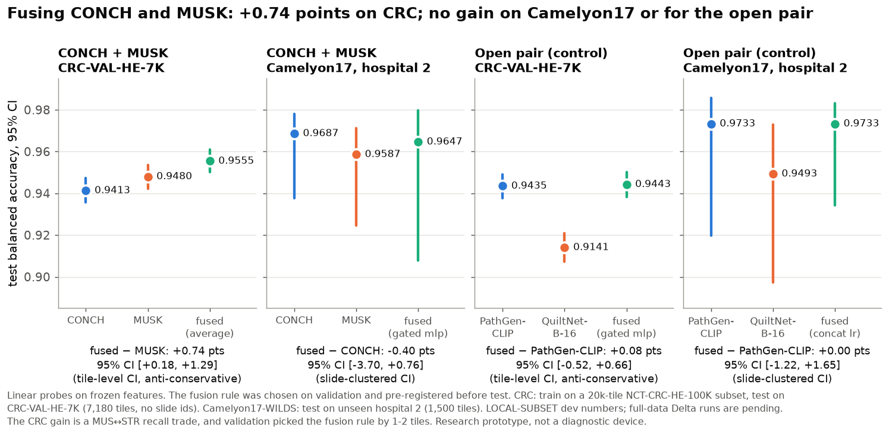
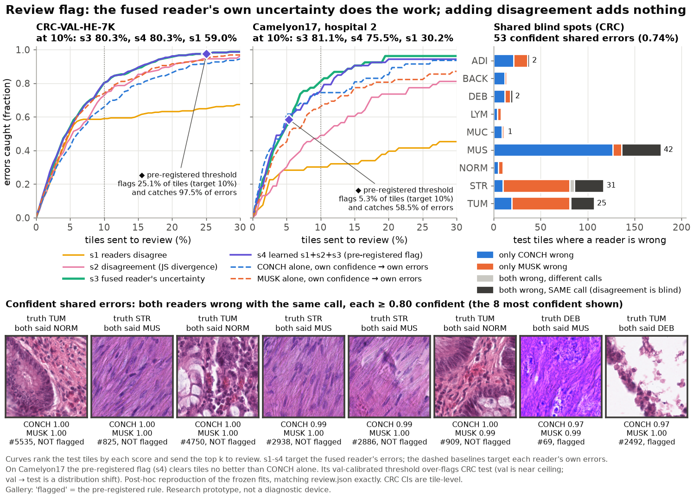
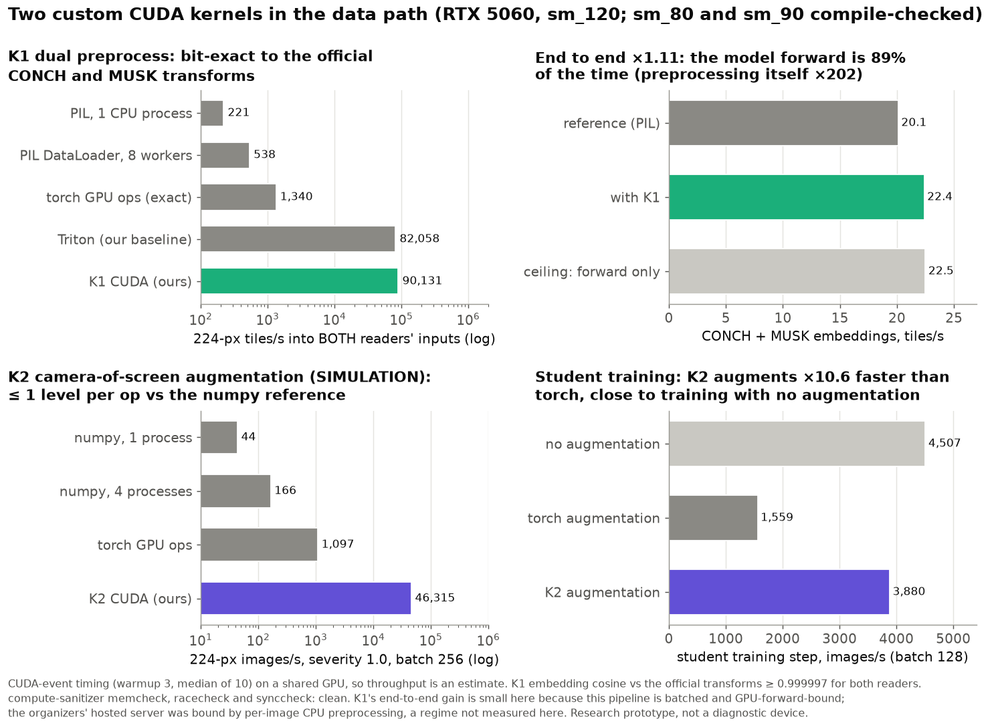
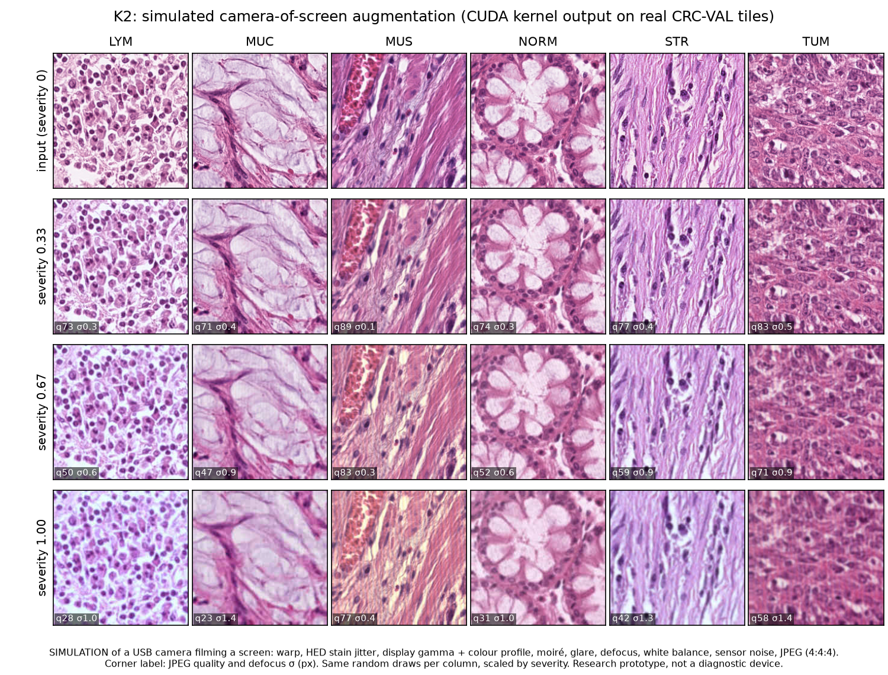
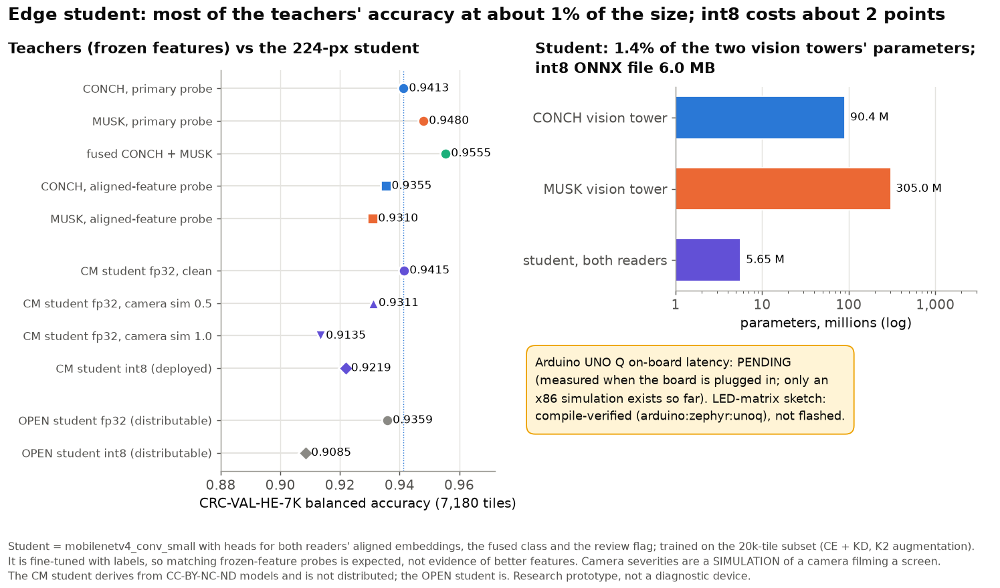
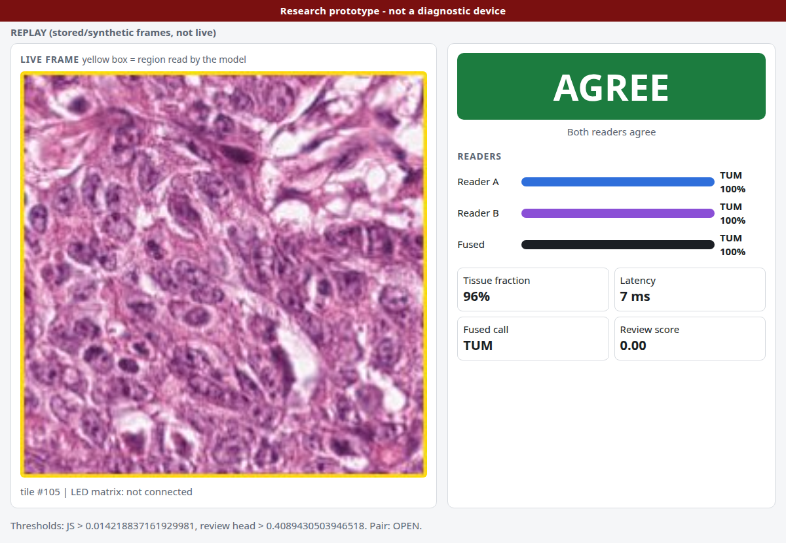
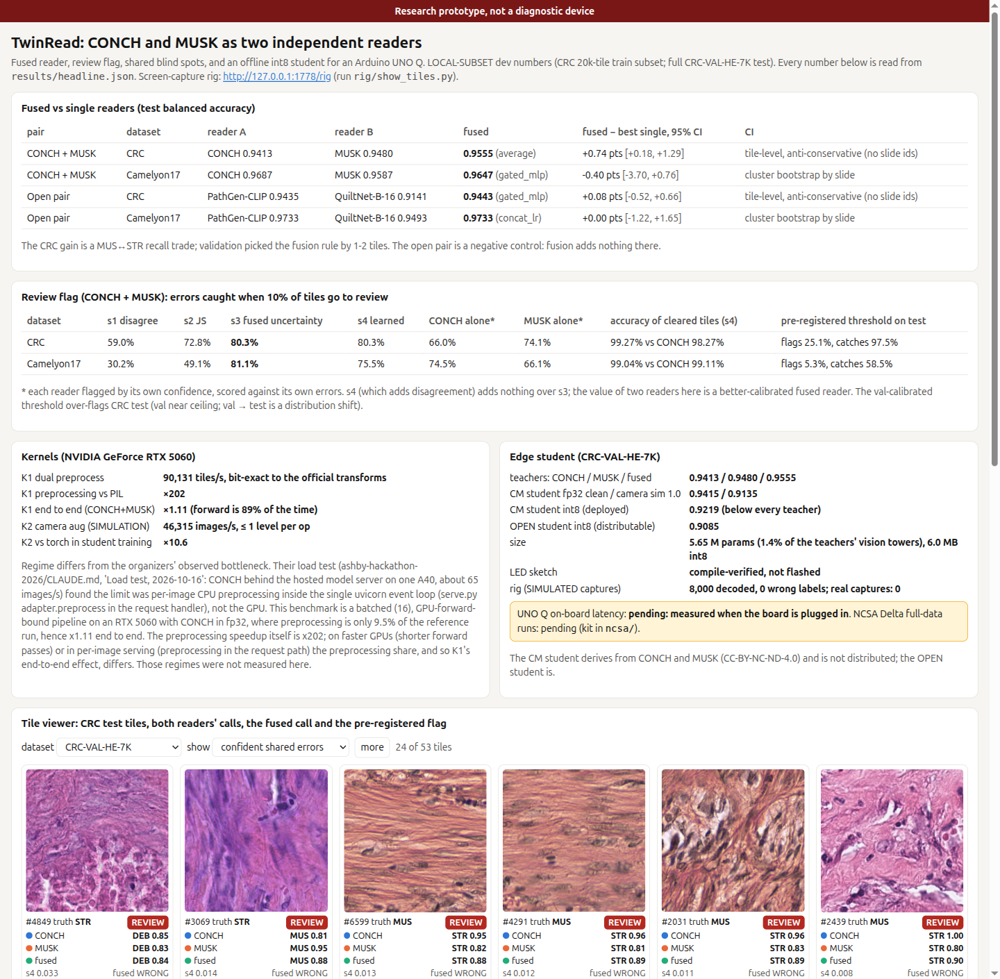

# TwinRead: CONCH and MUSK as two independent readers, fused, flagged and distilled to an offline Arduino UNO Q

**Research prototype, not a diagnostic device.** Every result number here is read from `results/**/*.json`, mostly via
`results/headline.json`, which `python -m twinread.headline` computes from the source files. Numbers are
**LOCAL-SUBSET dev numbers**; the full-data NCSA Delta runs are **pending**.

## Abstract

Pathology already has a safety habit for hard cases: a second, independent read. TwinRead asks whether CONCH and MUSK,
the two pathology foundation models the organizers highlight, can act as those two readers. Each model reads every H&E
tile through a linear probe on its frozen features. A pre-registered fusion rule combines the two, a review flag
decides which tiles go to a pathologist, and the pair is distilled into a 5.65 M-parameter int8 student that runs
offline on an Arduino UNO Q with a USB camera. The local subset uses 20k NCT-CRC-HE-100K training tiles and the full
CRC-VAL-HE-7K test set. There, fusion reaches 0.9555 balanced accuracy against 0.9480 for MUSK alone (+0.74 points,
tile-level CI). The gain is a muscle-versus-stroma trade, though, and fusion adds nothing on Camelyon17 or for an
open-model control pair. When 10% of tiles go to review, the fused reader's own uncertainty catches 80.3% of its
errors, against 74.1% for MUSK flagging itself, and adding disagreement adds nothing. So the value of two readers is a
better-calibrated combined reader, not disagreement as such. Two custom CUDA kernels make the pipeline cheap: one does
bit-exact preprocessing for both models, the other simulates a camera filming a screen. The int8 student keeps 0.9219
at 1.4% of the teachers' size. The Delta full-data runs and the on-board measurements are pending.



## Results at a glance

All test numbers were computed once, after `results/<pair>/<dataset>/preregistration.json` was written. Balanced
accuracy uses CRC-VAL-HE-7K (7,180 tiles, 9 classes) and Camelyon17-WILDS hospital 2 (1,500 tiles, unseen hospital).

| Question | Answer (local subset) | Source |
|---|---|---|
| Does fusing CONCH + MUSK beat the best single reader on CRC? | Yes, slightly: 0.9555 vs MUSK 0.9480 vs CONCH 0.9413; +0.74 pts, 95% CI [+0.18, +1.29], tile-level and anti-conservative (no slide ids); McNemar p = 0.0043 | `results/cm_local/CM/crc/fusion.json` |
| ...on Camelyon17 (unseen hospital)? | No: fused 0.9647 vs CONCH 0.9687, −0.40 pts [−3.70, +0.76], slide-clustered CI | `results/cm_local/CM/cam/fusion.json` |
| ...for the open control pair (PathGen-CLIP + QuiltNet-B-16)? | No: +0.08 pts [−0.52, +0.66] on CRC, 0.00 [−1.22, +1.65] on Camelyon17 | `results/open/OPEN/*/fusion.json` |
| Errors caught at a 10% review budget (CRC) | fused uncertainty (s3) 80.3%, learned s4 80.3%, JS disagreement 72.8%, plain disagreement 59.0%; MUSK alone 74.1%, CONCH alone 66.0% | `results/cm_local/CM/crc/review.json` |
| ...on Camelyon17 | s3 81.1%, s4 75.5%; CONCH alone 74.5%. Cleared-tile accuracy: s4 99.04% vs CONCH alone 99.11%, so no gain | `results/cm_local/CM/cam/review.json` |
| The pre-registered flag's actual test operating point | CRC: flags 25.1% of tiles (target 10%) and catches 97.5% of errors. Camelyon17: flags 5.3%, catches 58.5% | `review.json` `s4_val_threshold_operating_points` |
| Shared blind spots (both wrong, same call, both ≥ 0.80 confident) | 53 CRC tiles (0.74%), 36 of them MUS↔STR; 12 Camelyon17 tiles | `review.json`, `blindspots.csv` |
| K1 dual preprocess (CUDA) | 90,131 tiles/s into both readers' inputs, bit-exact to the official transforms; preprocessing ×202 vs PIL, but ×1.11 end to end (forward-bound) | `results/kernels/k1_*.json` |
| K2 camera-of-screen augmentation (SIMULATION) | 46,315 images/s; ≤ 1 level per op vs a numpy reference; student-training augmentation ×10.6 vs torch | `results/kernels/k2_*.json`, `results/student/*/throughput.json` |
| Edge student (CM, mobilenetv4_conv_small) | fp32 0.9415 (CONCH 0.9413), 0.9135 at the strongest simulated camera severity; deployed int8 0.9219, below every teacher | `results/student/cm_crc/*.json` |
| Size | 5.65 M parameters = 1.4% of the two teachers' vision towers (395.4 M); int8 ONNX 6.0 MB | `results/student/model_sizes.json` |
| UNO Q | LED-matrix sketch compile-verified (`arduino:zephyr:unoq`), not flashed. On-board latency **pending: measured when the board is plugged in** | `results/uno_q/mcu_compile.json` |

## Problem and idea

A second read catches errors, but it costs a second pathologist. TwinRead tests three cheaper versions of it.

- **A combined reader.** CONCH (CoCa, ViT-B/16, 448 px, 512-d) and MUSK (BEiT-3-style, 384 px, 100-token text limit)
  were trained differently, so they might fail on different tiles. A fused reader should beat either one.
- **A review flag.** Send the tiles the system is least sure about to a pathologist. The design compared four signals:
  s1 = the readers disagree, s2 = Jensen-Shannon divergence between them, s3 = 1 − the fused reader's top probability,
  and s4 = a logistic combination of s1-s3 fitted on validation. The baselines are each reader alone, flagged by its
  own confidence.
- **Shared blind spots.** Disagreement cannot catch an error both readers make. We count where that happens.
- **An offline edge copy.** A small student learns both readers' embeddings, the fused call and the review label.
  It runs on an Arduino UNO Q (4× Cortex-A53, no CUDA) with a USB camera, for settings with no scanner, no GPU and no
  reliable internet.

## Two configurations, and why (licences)

CONCH and MUSK are **CC-BY-NC-ND-4.0**, which bars commercial use and derivatives. Whether a distilled student
counts as a derivative is legally unsettled, so TwinRead is generic over the reader pair and ships two configurations.

| | **TwinRead-CM** (research) | **TwinRead-OPEN** (distributable) |
|---|---|---|
| Readers | CONCH + MUSK | PathGen-CLIP (CC-BY-4.0) + QuiltNet-B-16 (MIT) |
| Partner choice | the organizers' pair | QuiltNet-B-16 chosen on validation only, over BiomedCLIP (lower error correlation; `results/open/partner.json`) |
| Student / bundle | `bundles/cm/` is git-ignored and marked `distributable: false`; never shipped | `bundles/open/` (config + SHA256SUMS committed); test balanced accuracy fp32 0.9359, int8 0.9085 |
| Role here | the scientific result | negative control for fusion, and the bundle a hospital could actually be given |

## What was built

1. **Readers** (`twinread.readers`). The CONCH and MUSK semantics are copied from the organizer adapters (CONCH
   `encode_image(proj_contrast=True, normalize=True)`; MUSK fp16, `with_head=True, out_norm=True`). Each reader is
   probed on the features its authors recommend for linear probing (CONCH before the projection, MUSK `ms_aug`). The
   text-aligned embeddings drive zero-shot, the student targets and the device.
2. **Analysis** (`twinread.analyze`). Probes, three fusion candidates (average, concatenated logistic regression,
   gated MLP), signals s1-s4 and blind spots. Everything is fitted on train/val. `preregistration.json` (fusion rule,
   best single reader, thresholds, prompt hashes) is written before any test label is read, and it is never edited.
   The student's train-split targets are out-of-fold (5 folds; CRC grouped by parquet group). Camelyon17 CIs are
   cluster-bootstrapped by slide. CRC has no slide ids, so its CIs are tile-level and labelled anti-conservative.
3. **Kernels** (`src/twinread/csrc/`, `twinread.kernels`): K1 and K2, below.
4. **Student** (`twinread.student`, `scripts/train_student.py`). `mobilenetv4_conv_small` at 224 px with four heads:
   hA and hB (the two readers' aligned spaces), a fused-class head and a review head. Losses: cosine + KD + CE + BCE.
   Clean-tile teacher targets, K2-augmented inputs.
5. **Export** (`twinread.export`, `scripts/make_bundle.py`). ONNX → ORT static int8 (QDQ, per-channel, percentile
   calibration on 512 train tiles). Thresholds are recalibrated on the int8 model's validation outputs, and the bundle
   is SHA256-verified on load.
6. **Device** (`device/`). An offline camera → crop → int8 student → AGREE/REVIEW loop, with a local web UI and an
   8×13 LED-matrix sketch over the Bridge RPC. Missing camera or Bridge falls back with a logged reason.
7. **Screen-capture rig** (`rig/`). It shows held-out tiles with a parity-checked frame-ID marker for the camera to
   film (`rig/show_tiles.py`, http://127.0.0.1:1778/rig), then decodes and crops the captures.
8. **Host dashboard** (`twinread.app_host`, http://127.0.0.1:1777). Headline tables plus a tile viewer with both
   readers' calls, the fused call and the pre-registered flag.

## Findings

### 1. Fusion: a small, fragile gain on CRC only



- On CRC the pre-registered rule (`average`) beats MUSK by +0.74 points. The CI excludes zero, but it is tile-level and
  anti-conservative.
- The gain is a **MUS↔STR recall trade**: fused minus MUSK recall is −13.2 points on MUS and +13.1 on STR
  (`results/cm_local/CM/crc/post_hoc_class_candidates_s3s4.json`, post hoc).
- Validation picked `average` by 1-2 tiles: 2,641 correct of 2,658, against 2,640 for the gated MLP and 2,639 for
  concat-LR. The gated MLP scores −0.40 points against MUSK on test. Validation is near ceiling (fused 0.9936).
- On Camelyon17 hospital 2 nothing beats CONCH alone.
- For the open control pair, PathGen-CLIP plus a 3-point-weaker QuiltNet-B-16 gives no gain on either dataset. The one
  gain appeared only where the two readers were about equally strong. That is consistent with complementarity
  mattering, but one pair cannot show it.

### 2. Review flag: the fused reader's own uncertainty does the work



- **CRC, 10% review budget.** s3 (fused uncertainty) and s4 (learned) both catch 80.3% of fused errors. MUSK flagging
  its own errors catches 74.1%, CONCH 66.0%.
- **s4 adds nothing over s3.** Their test rankings correlate at Spearman 0.9999, and the two top-10% sets overlap by
  99.7%. Pure disagreement is weaker: s1 catches 59.0% and s2 72.8%.
- **Camelyon17.** The twin system does not beat CONCH alone. s4 clears tiles at 99.04% accuracy against 99.11% for
  CONCH flagging itself. s4's AURC is 0.0066, worse than s3's 0.0027.
- **The honest reading.** Two readers help by producing a better-calibrated fused reader, not because their
  disagreement is informative in itself.
- **The pre-registered threshold does not transfer.** The val-calibrated rule flags 25.1% of CRC test tiles instead of
  10%, because CRC validation is near ceiling and val → test is a distribution shift (NCT-CRC-HE-100K → CRC-VAL-HE-7K,
  a different patient set). It catches 97.5% of errors at that cost. On Camelyon17 it flags 5.3% and catches 58.5%.
  Both are reported as measured.
- **Blind spots.** 53 CRC test tiles (0.74%) are confident shared errors, which no disagreement signal can catch.
  36 of them are MUS↔STR (23 STR called MUS, 13 the reverse), so the two readers share the same muscle/stroma
  ambiguity. On Camelyon17, 11 of the 12 confident shared errors pass the pre-registered flag unflagged (8 tumor tiles
  called normal); on CRC the over-flagging threshold happens to catch 47 of 53.

The triage curves and the tile viewer use a **post-hoc reproduction** of the frozen fits (`scripts/export_tile_preds.py`).
It reproduces every errors-caught and AURC value in `review.json`, and the stored review labels, exactly (32 checks per
dataset, `results/cm_local/CM/*/triage_curves.json`). Nothing was re-selected on test.

### 3. Kernels: verified, fast, honestly bounded



- **K1 fused dual preprocess** (CUDA C++, with Triton and torch baselines). One launch turns a uint8 tile batch into
  both readers' normalized fp16 inputs (CONCH 448 px, MUSK 384 px, bicubic, center crop). It mirrors Pillow's resampling
  coefficients and is **bit-exact to `official_transform(img).half()`** for both readers on CRC tiles, mosaic frames and
  random non-square sizes. Embedding cosine against the reference is ≥ 0.999997.
- K1 throughput is 90,131 tiles/s on the RTX 5060, against 221 for single-process PIL, 538 for an 8-worker DataLoader
  and 82,058 for our Triton version.
- **End to end the gain is ×1.11, and the reason matters.** In this batched pipeline the CONCH + MUSK forward pass is
  89% of the time. K1 makes preprocessing ×202 faster, but the ceiling with free preprocessing is ×1.118. The
  organizers' hosted server was bound by per-image CPU preprocessing in the request handler. That regime, and faster
  GPUs, were not measured here (`results/kernels/k1_embed_e2e.json`, `context`).
- **K2 camera-of-screen augmentation (SIMULATION).** One launch per batch with per-image Philox parameters. It applies
  perspective warp, HED stain jitter, display gamma and colour profile, moiré, glare, defocus, white balance, sensor
  noise and 8×8-block JPEG.
- K2 runs at 46,315 images/s, against 1,097 for torch GPU ops and 44 for single-process numpy. Every op is within 1
  level of the numpy float64 reference.
- In the full composition, larger differences (up to 11 levels) occur only in JPEG blocks where a coefficient sits
  within float32 error of a rounding boundary. Those are 0.11% of blocks, identified and exempted by
  `camera_ops.decompose_differences`. compute-sanitizer memcheck, racecheck and synccheck are clean.
- In student training, K2 augments ×10.6 faster than torch. A training step with K2 runs at 3,880 images/s, against
  1,559 with torch augmentation and 4,507 with none.
- Both kernels build for sm_120 (run here) and compile for sm_80 / sm_90 (Delta A100 / DeltaAI GH200), compile-checked
  only.



### 4. Edge student and device



- **Accuracy.** The CM student (fp32) scores 0.9415 on clean CRC-VAL-HE-7K tiles, tying CONCH (0.9413). Under
  simulated camera capture it scores 0.9311 at severity 0.5 and 0.9135 at 1.0. It is fine-tuned with labels, so
  matching frozen-feature probes is expected, not evidence of better features.
- **The deployed int8 model is 0.9219, below every teacher**, including the aligned-feature probes (CONCH 0.9355, MUSK
  0.9310). int8 costs more on test (0.9415 → 0.9219) than on validation (0.9823 → 0.9774). Calibration uses 512 clean
  train tiles and test is a different patient set; this is not yet addressed.
- **Size.** The student has 5.65 M parameters, 1.4% of the two vision towers. The int8 ONNX file is 6.0 MB. The value
  is offline, small and cheap, not beating the foundation models.
- **On-device flag.** On clean test tiles it flags 14.3% and catches 79.5% of the student's own errors
  (`results/student/cm_crc/metrics.json`).
- **Device status.**
  - The app runs offline in replay and camera modes.
  - The LED-matrix sketch is compile-verified for `arduino:zephyr:unoq`, but **not flashed**.
  - **UNO Q on-board latency is pending: measured when the board is plugged in.** Only an x86 simulation table exists
    (`results/uno_q/backbone_latency_x86_sim.json`), and its numbers are not UNO Q numbers.
- **Rig.**
  - The capture rig decoded 8,000 **simulated** camera-of-screen captures with 0 wrong labels. Worst-case acceptance
    was 89.25% at severity 1.0.
  - **No real camera captures exist yet.**



*The device app on this x86 desktop, not the UNO Q. It runs the distributable OPEN int8 bundle, replaying a real
CRC-VAL-HE-7K tile in REPLAY mode. The latency shown is the x86 host's.*

### 5. Host dashboard



`python -m twinread.app_host` serves http://127.0.0.1:1777. It shows the headline tables and a tile viewer with
filters: confident shared errors, fused errors not flagged, disagreements and flagged tiles. The viewer shows both
readers' calls, the fused call and the pre-registered flag for every test tile. The page links the rig page on 1778.

## How to run

```bash
cd twinread-conch-musk-edge
bash run_demo.sh --smoke          # no GPU / network: headline JSON, figures -> build/smoke_figures/, manifest tests, dashboard check
bash run_demo.sh                  # data -> OPEN embeddings (GPU lock) -> analysis -> student -> bundle -> figures -> dashboard :1777
bash run_demo.sh --with-cm        # + CONCH/MUSK local subset (needs Hugging Face access to MahmoodLab/CONCH and xiangjx/musk)
PYTHONPATH=src ../.venv/bin/python -m twinread.app_host            # dashboard only, http://127.0.0.1:1777
../.venv/bin/python rig/show_tiles.py                             # capture rig page, http://127.0.0.1:1778/rig
CUDA_VISIBLE_DEVICES="" ../.venv/bin/python -m pytest tests -q    # CPU suite (< 2 min); GPU suite: flock ../.gpu.lock ... -m gpu
```

`device/README.md` covers the UNO Q app, the offline install and the bundle rebuild; `ncsa/README.md` covers Delta.

## Event scale-up (NCSA Delta)

The kit in `ncsa/` is written and tested locally (static tests only). **Nothing has run on Delta yet**, and every
Delta command needs the user's explicit OK. The plan, from `ncsa/README.md`:

1. **Login node.** Install CONCH and MUSK into the user site (`setup_login.sh`) and pre-download the weights
   (`download_weights.py`), because compute nodes have no internet. Then stage NCT-CRC-HE-100K from
   `/projects/bfqi/shared/datasets/` (`stage_data.sh`).
2. **J1** (≤ 0.5 h A100). Environment check, offline CONCH/MUSK load, and the K1/K2 JIT build for sm_80.
3. **J2** (≤ 1.5 h). CONCH + MUSK embeddings of the **full 100k + 7k** CRC tiles through K1. It falls back to the
   reference transforms if the build failed.
4. **CPU analysis** (`analyze_cpu.sbatch` or locally). The same pre-registered `run_pair_analysis`.
5. **J3** (≤ 1.5 h). CM student distillation on the full data with K2.
6. **J4** (optional). A second seed or the OPEN pair.

The target is ≤ 10 A100-hours of a 30-hour budget. Swapping in another reader pair is one entry in `PAIRS`. PathMMU
subsets with recoverable labels are a stretch task.

## Limitations

- **Local-subset dev numbers.** 20k of 100k CRC training tiles and a 7.5k Camelyon17 subset. Full-data Delta numbers
  are pending.
- **CRC has no slide or patient ids**, so CRC CIs and McNemar tests are tile-level and anti-conservative. Validation is
  group-disjoint by parquet group, not guaranteed slide-disjoint.
- **The CRC fusion gain is fragile.** It is a MUS↔STR trade, the rule was chosen by 1-2 validation tiles, and there is
  no gain on Camelyon17 or for the open pair.
- **The review flag's value is the fused reader's uncertainty, not disagreement.** The val-calibrated threshold
  over-flags CRC test (25.1% vs 10%).
- **Shared blind spots.** 0.74% of CRC tiles are confident errors that both readers share; no two-reader flag can
  catch them.
- **The int8 student is below every teacher on test** (0.9219), and int8 drift on test is larger than on validation.
- **Device.**
  - UNO Q latency, the offline demo and the LED sketch on hardware are not yet measured.
  - The sketch is compile-verified only.
  - The device screenshot is an x86 replay.
- **Camera.** The camera demo films a screen, not a microscope. All camera numbers so far are SIMULATION (K2,
  `rig/sim_capture.py`); there are no real captures yet.
- **Kernel throughput** comes from a GPU and CPU shared with other jobs, so it is an estimate. sm_80 and sm_90 are
  compile-checked only.
- **Licence.** The CM student derives from CC-BY-NC-ND-4.0 models and is not distributed. Only the OPEN bundle is.
- **Downloads.** Local data downloads (~4.3 GB for the CRC subset and test set) exceed the bench's ~2 GB guideline.
  They live in `data/` and are never committed.
- **Not clinically validated.** This is a research prototype, not a diagnostic device.

## Files

`src/twinread/` holds the library:

- `readers`, `data`, `embed`, `probes`, `fusion`, `review`, `blindspots`, `analyze`: the pipeline;
- `kernels` and `csrc/`: K1 and K2;
- `student`, `export`: the edge student and its int8 export;
- `tilepreds`: the post-hoc per-tile reproduction;
- `headline`: the derived numbers;
- `figures`, `app_host`: the figures and the dashboard.

Elsewhere:

- `scripts/`: pipeline entry points;
- `device/`: the UNO Q app and MCU sketch;
- `rig/`: the capture rig;
- `ncsa/`: the Delta kit;
- `results/`: metrics JSON (the npz files are git-ignored);
- `figures/`: 8 PNGs;
- `docs/design.md`, `docs/plan.md`, `docs/deck_outline.md`, `PROGRESS.md`: design, plan, deck outline and progress log.

## References

- Lu et al., CONCH, *Nature Medicine* 2024: `reference/papers/lu2024_conch.md`.
- Xiang et al., MUSK, *Nature* 2025: `reference/papers/xiang2025_musk.md`.
- Ikezogwo et al., Quilt-1M, 2023: `reference/papers/ikezogwo2023_quilt1m.md` (QuiltNet).
- Sun et al., PathMMU, 2024: `reference/papers/sun2024_pathmmu.md`.
- Li et al., multimodal computational pathology survey, 2025: `reference/papers/li2025_multimodal_cpath_survey.md`.
- Muneer et al., multimodal integration review, 2026: `reference/papers/muneer2026_multimodal_integration_review.md`.
- Datasets:
  - NCT-CRC-HE-100K / CRC-VAL-HE-7K (Kather et al., CC-BY-4.0, via `1aurent/NCT-CRC-HE`);
  - Camelyon17-WILDS (CC0, via `wltjr1007/Camelyon17-WILDS`).
- Open models:
  - PathGen-CLIP (`jamessyx/pathgenclip-vit-large-patch14-hf`, CC-BY-4.0);
  - QuiltNet-B-16 (`wisdomik/QuiltNet-B-16`, MIT);
  - BiomedCLIP (MIT);
  - timm `mobilenetv4_conv_small`.
