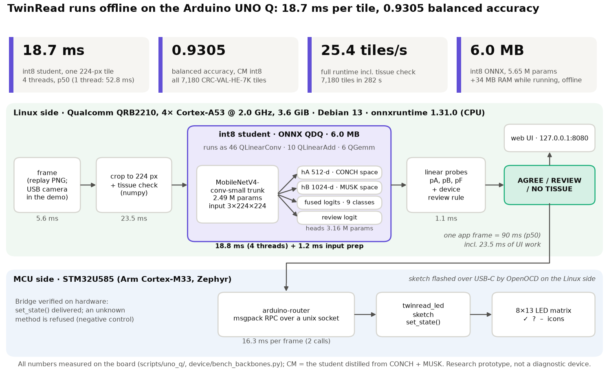
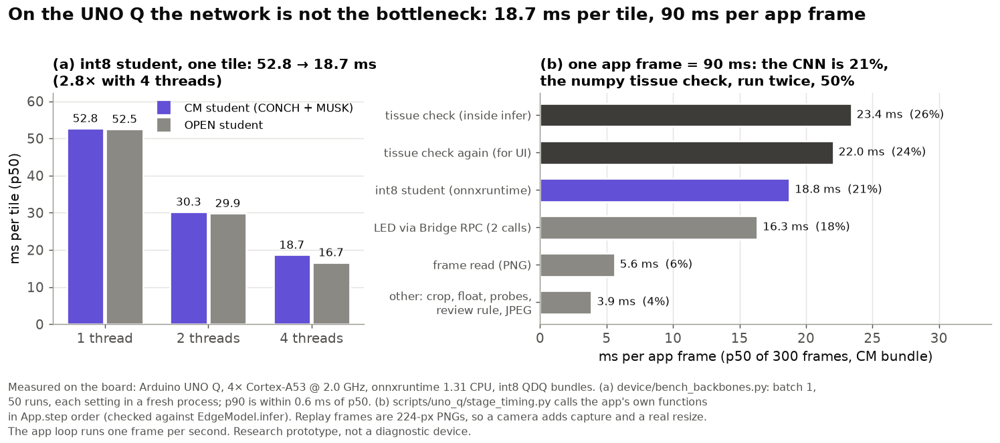
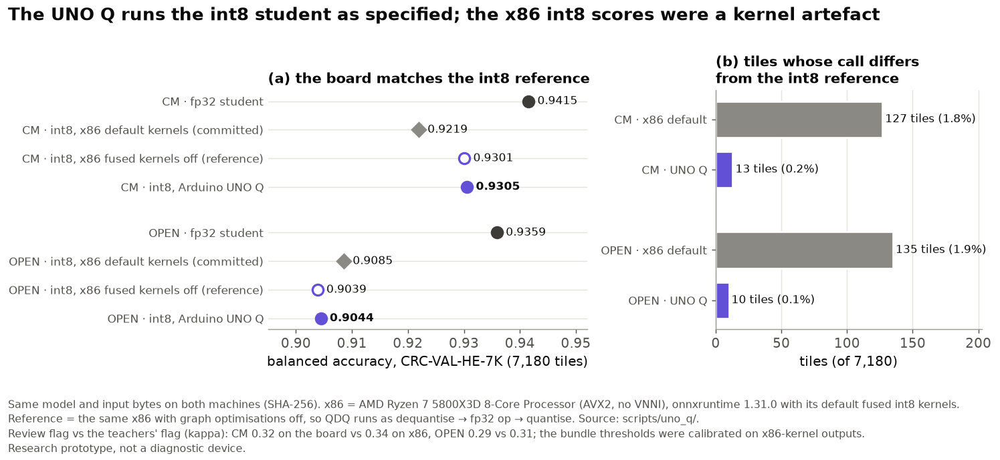
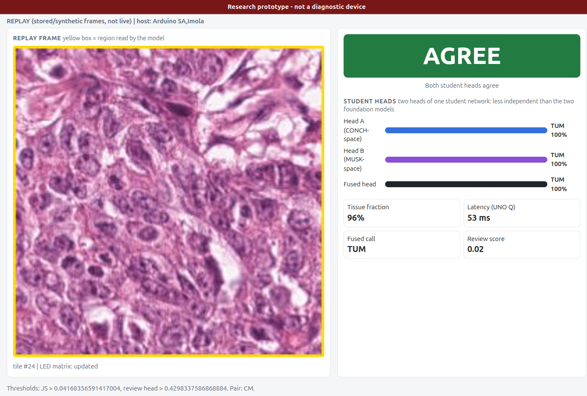

# TwinRead

**Research prototype, not a diagnostic device.** Every number here comes from `results/**/*.json`
(`python -m twinread.headline` collects them into `results/headline.json`). Model numbers are from a local subset on
one RTX 5060. Device numbers are measured on the Arduino UNO Q.

## Abstract

Pathology has a safety habit for hard cases: a second, independent read. TwinRead asks whether CONCH and MUSK,
the organizers' two pathology foundation models, can act as those two readers. Linear probes on their frozen
features are fused by a pre-registered rule, and a review flag picks tiles for a pathologist. On a local subset
(20k NCT-CRC-HE-100K training tiles, full CRC-VAL-HE-7K test), fusion reaches 0.9555 balanced accuracy against
0.9480 for MUSK alone (+0.74 points, tile-level CI), mostly through tumour recall. It adds nothing on Camelyon17
or for an open-model control pair. On CRC, at a 10% review budget, the fused reader's own uncertainty catches
80.3% of its errors against 74.1% for MUSK flagging itself; adding disagreement adds nothing. On Camelyon17 the
flag does not beat CONCH alone, and the pre-registered threshold over-flags CRC (25.1% of tiles, not 10%). Two
readers help by making a better-calibrated reader, not through disagreement. Custom CUDA kernels speed up
preprocessing ×202 (×1.11 end to end) and training augmentation ×10.6. A 6 MB int8 student distilled from both
readers runs offline on an Arduino UNO Q. Measured on the board, it takes 18.7 ms per tile and scores 0.9305 on the
full CRC test set, below every teacher but small and cheap. For patients, a cheap offline second look could help
where no second pathologist is available. Research prototype, not clinically validated.


## Idea

Each reader is a linear probe on frozen CONCH or MUSK features. A fusion rule is chosen on validation and
pre-registered before any test label is read. A review flag sends the least certain tiles to a pathologist, comparing
four signals: s1 = the readers disagree, s2 = Jensen-Shannon divergence, s3 = 1 − the fused top probability,
s4 = a logistic combination of s1-s3. A `mobilenetv4_conv_small` student learns both readers' embeddings, the fused
call and the review label, and is exported to int8 ONNX for an offline Arduino UNO Q.
CONCH and MUSK are CC-BY-NC-ND-4.0, so **TwinRead-CM** (the scientific result) never distributes its student, while
**TwinRead-OPEN** (PathGen-CLIP + QuiltNet-B-16) is the control pair and the distributable bundle (`bundles/open`).

## Results

Test sets: CRC-VAL-HE-7K (7,180 tiles, 9 classes; training on a 20k-tile NCT-CRC-HE-100K subset) and
Camelyon17-WILDS hospital 2 (1,500 tiles, unseen hospital). Every test number was computed once, after
`preregistration.json` was written.

| Question | Answer | Source |
|---|---|---|
| Fusing CONCH + MUSK vs the best single reader, CRC | 0.9555 vs MUSK 0.9480 (CONCH 0.9413): +0.74 pts, 95% CI [+0.18, +1.29], tile-level and anti-conservative. Opposing MUS/STR recall swings cancel; the net gain is mostly tumour recall (+3.6 pts) | `results/cm_local/CM/crc/fusion.json` |
| ...Camelyon17 | No gain: 0.9647 vs CONCH 0.9687 (−0.40 pts, slide-clustered CI) | `results/cm_local/CM/cam/fusion.json` |
| ...open control pair | No gain: +0.08 pts on CRC, 0.00 on Camelyon17 | `results/open/OPEN/*/fusion.json` |
| Errors caught at a 10% review budget, CRC | fused uncertainty s3 80.3%, learned s4 80.3%, JS s2 72.8%, disagreement s1 59.0%†; MUSK alone 74.1%, CONCH alone 66.0% | `results/cm_local/CM/crc/review.json` |
| ...Camelyon17 | s3 81.1%, s4 75.5%, CONCH alone 74.5%; cleared-tile accuracy s4 99.04% vs CONCH 99.11%, so the twin flag does not beat CONCH alone | `results/cm_local/CM/cam/review.json` |
| Pre-registered threshold on test | CRC: flags 25.1% of tiles for a 10% target and catches 97.5% of errors. Camelyon17: flags 5.3%, catches 58.5% | `review.json` |
| Confident shared errors (both wrong, same call, both ≥ 0.80) | 53 CRC tiles (0.74%), 36 of them MUS↔STR; 12 Camelyon17 tiles | `review.json`, `triage_curves.json` |
| K1 dual-reader preprocessing (CUDA) | Bit-exact to the official transforms. 90,131 tiles/s with the input on the GPU (46,157 incl. the host copy); ×202 vs PIL inside the embedding run, ×1.11 end to end (forward-bound) | `results/kernels/k1_*.json` |
| K2 augmentation (CUDA, simulated camera-of-screen degradation) | 46,315 images/s, ≤ 1 level per op vs a numpy reference; student training ×10.6 faster than torch augmentation | `results/kernels/k2_*.json`, `results/student/*/throughput.json` |
| CM student, CRC (x86) | fp32 0.9415 (ties CONCH); int8 0.9219 with onnxruntime's default x86 kernels, 0.9301 with them off | `results/student/cm_crc/`, `results/uno_q/onboard/int8_kernel_check.json` |
| Size | 5.65 M parameters (1.4% of the two vision towers); 6.0 MB int8 ONNX | `results/student/model_sizes.json` |
| On the Arduino UNO Q | int8 student 18.7 ms per tile (4 threads); 0.9305 balanced accuracy on all 7,180 CRC test tiles; 25.4 tiles/s for the full app loop | `results/uno_q/onboard/` |

† s1 is binary. At a 10% budget it flags the 5.6% of tiles where the readers disagree; the remaining 4.4% of the
budget is filled with agreeing tiles in shuffled test order, which is effectively random.

**Reading.** Two readers help by producing a better-calibrated fused reader, not because disagreement is informative:
s4 and s3 rank tiles almost identically (Spearman 0.9999). The CRC gain is fragile: validation picked the `average`
rule by 1-2 tiles at a near-ceiling 0.9936, and the val-calibrated threshold over-flags the test patients.


## On the Arduino UNO Q



- Board: Qualcomm QRB2210, 4× Cortex-A53 at 2.0 GHz, 3.6 GiB RAM, Debian 13, onnxruntime 1.31 on CPU. The int8 CM
  student takes 18.7 ms per 224 px tile at 4 threads (52.8 ms single-threaded) and 34 MB of RAM. One app frame is
  about 90 ms; the numpy tissue check, not the network, is the largest cost.
- Full CRC-VAL-HE-7K on the board: 0.9305 balanced accuracy (CM) and 0.9044 (OPEN), 7,180 tiles in 282 s. The lower
  x86 int8 scores (0.9219 and 0.9085) were an onnxruntime kernel artefact: with the fused int8 kernels off, x86
  matches the board (13 of 7,180 CM calls differ).
- The device's two "readers" are two heads on one shared student backbone, far less independent than CONCH and
  MUSK. Against the teacher flag, the fp32 student's flag agrees on 81.2% of tiles (kappa 0.42) and recovers 41.0%
  of teacher-flagged tiles; the x86 int8 run agrees on 79.5% (kappa 0.34) and recovers 33.3%
  (`results/student/cm_crc/int8_flag_fidelity.json`). On the board the int8 flag agrees on 79.6% (kappa 0.32),
  flags 10.2% of tiles and catches 57.2% of the board model's own errors (x86 int8: 12.1% flagged, 57.6% caught).
- The LED-matrix sketch is flashed (OpenOCD over USB-C) and each Bridge RPC call to the MCU costs 8 ms. The app has
  run on the board in replay mode on stored tiles; there are no real camera captures yet.







## How to run

```bash
bash run_demo.sh --smoke     # no GPU or network: headline JSON, figures, manifest tests, dashboard check
bash run_demo.sh             # data -> OPEN embeddings (GPU lock) -> analysis -> student -> int8 bundle -> figures -> dashboard :1777
bash run_demo.sh --with-cm   # also the CONCH + MUSK local subset (needs Hugging Face access to both models)
bash run_demo.sh --dry-run   # print the plan; heavy steps are only printed
CUDA_VISIBLE_DEVICES="" ../.venv/bin/python -m pytest tests -q                                   # CPU suite, < 2 min
flock ../.gpu.lock env TWINREAD_GPU_TESTS=1 PATH=/usr/local/cuda/bin:$PATH ../.venv/bin/python -m pytest tests -q -m gpu
```

The scripts expect the bench venv at `../.venv` (set `BENCH=<dir>` for a clone elsewhere). GPU tests run only with
`TWINREAD_GPU_TESTS=1`; reader tests skip without cached weights. `python -m twinread.app_host` serves a dashboard
with a tile viewer on http://127.0.0.1:1777. `device/README.md` covers the board; `scripts/uno_q/` holds the
on-board measurement scripts.

## Future steps

1. Real camera captures. Film tiles shown on a screen with the USB camera through `rig/` and score them on the
   board. Camera robustness so far is the K2 simulation.
2. Full-data run on NCSA Delta. The kit in `ncsa/` embeds all 100k CRC training tiles with CONCH and MUSK (J1-J3,
   ≤ 10 A100-hours) to test whether the fragile fusion gain holds with 5× the training data.
3. CRC slide ids for clustered CIs, and per-site threshold calibration.

## Limitations

- Teacher and student training numbers are from a local subset (20k of 100k CRC training tiles, 7.5k Camelyon17
  tiles).
- CRC has no slide ids: its CIs and McNemar tests are tile-level and anti-conservative; validation is
  group-disjoint, not guaranteed slide-disjoint.
- The CRC fusion gain is fragile, and the flag's value is the fused reader's uncertainty, not disagreement.
  0.74% of CRC tiles are confident errors shared by both readers, which no disagreement signal can catch.
- The int8 student is below every teacher, and its flag matches the teacher flag only at kappa 0.32 on the board.
- The board has only seen stored tiles. All camera numbers are simulated (K2).
- Kernel throughput comes from a shared GPU; sm_80 and sm_90 builds are compile-checked only.
- The CM student derives from CC-BY-NC-ND models and is not distributed. Local downloads (~4.3 GB) exceed the
  bench's ~2 GB guideline and live in `data/`, never in git.

## Layout

`src/twinread/` library (readers, data, embed, probes, fusion, review, blindspots, analyze, kernels + `csrc/`,
student, export, tilepreds, headline, figures, figures_unoq, app_host) · `scripts/` pipeline entry points and
`scripts/uno_q/` board measurements · `bench/` kernel benchmarks · `device/` UNO Q app and MCU sketch · `rig/` capture
rig · `ncsa/` Delta kit · `prompts/` frozen prompt ensembles · `results/` metrics JSON · `figures/` (8 manifest
figures; `uno_q/` and `extra/` hold the rest) · `docs/` design, plan, deck outline, status, progress log and build
rulings.

## References

- Lu MY et al. A visual-language foundation model for computational pathology (CONCH). *Nat Med* 2024. doi:10.1038/s41591-024-02856-4
- Xiang J et al. A vision-language foundation model for precision oncology (MUSK). *Nature* 2025. doi:10.1038/s41586-024-08378-w
- Ikezogwo WO et al. Quilt-1M (QuiltNet). NeurIPS 2023. arXiv:2306.11207
- Sun Y et al. PathMMU. ECCV 2024. arXiv:2401.16355
- Li et al. Multi-modal foundation models for computational pathology: a survey. 2025. PMC13081565
- Muneer A et al. Review on multimodal data integration for cancer research. *Artif Intell Rev* 2026. doi:10.1007/s10462-026-11522-9
- Data: NCT-CRC-HE-100K / CRC-VAL-HE-7K (Kather et al., CC-BY-4.0, `1aurent/NCT-CRC-HE`); Camelyon17-WILDS (CC0, `wltjr1007/Camelyon17-WILDS`)
- Models: `jamessyx/pathgenclip-vit-large-patch14-hf` (CC-BY-4.0), `wisdomik/QuiltNet-B-16` (MIT), BiomedCLIP (MIT), timm `mobilenetv4_conv_small`
